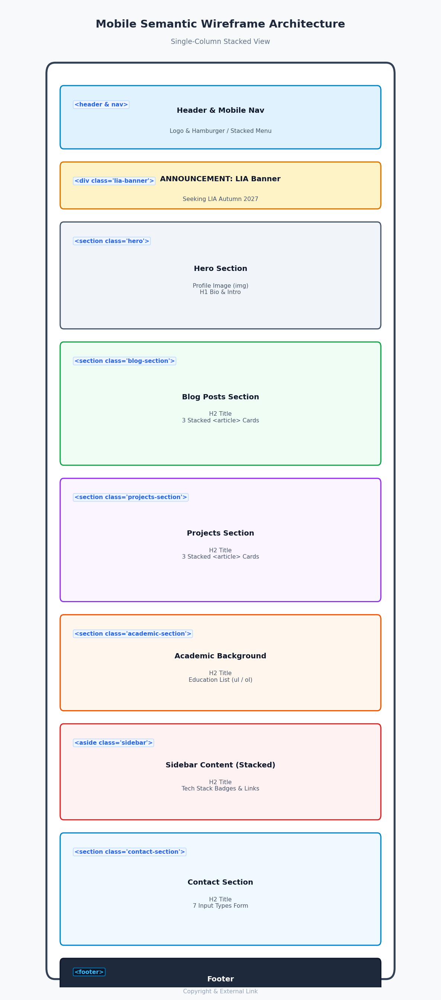
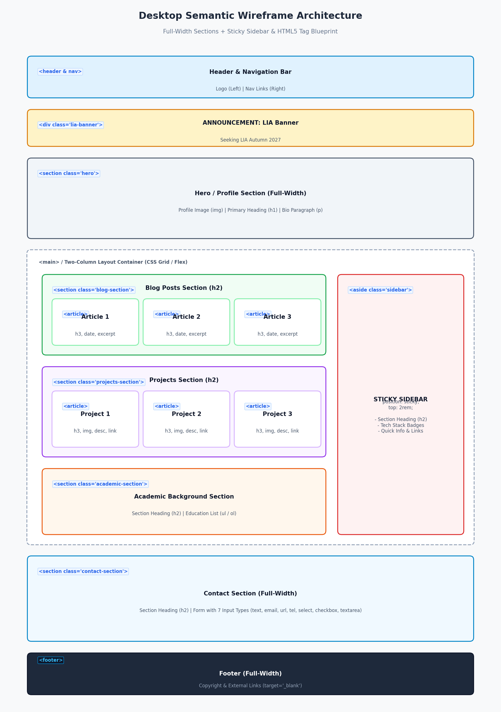
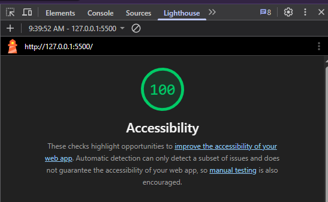
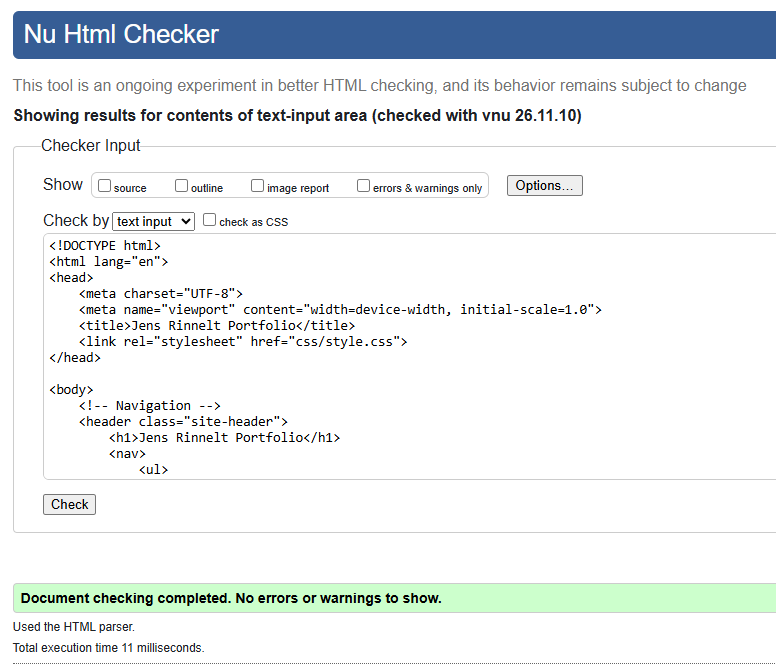
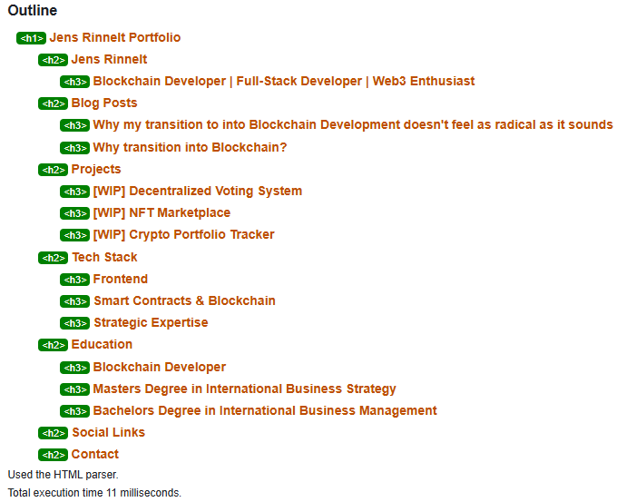
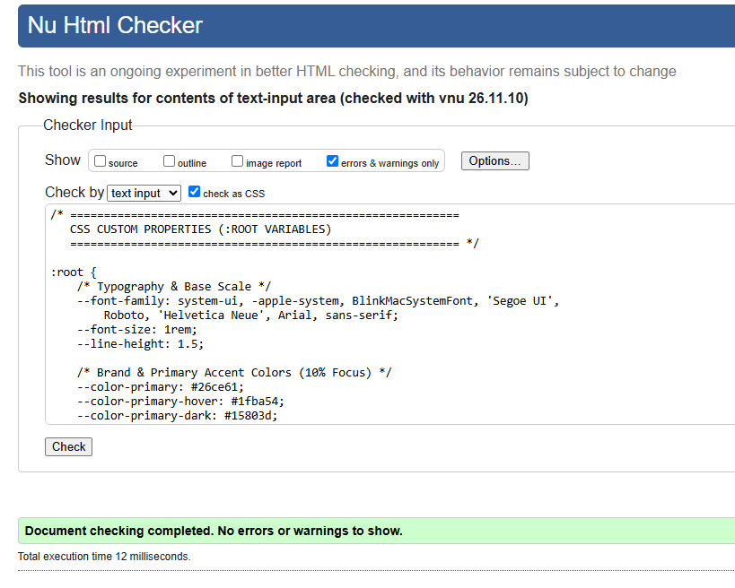

# 🚀 Developer Portfolio & CV

A modern, responsive personal portfolio website built with semantic HTML5 and custom CSS. Designed to showcase developer projects, academic background, and blog articles while seeking a _LIA (Internship) for Autumn 2027_. Developed for Medieinstitutet HTML & CSS course. 

[Link to Live Site on GitHub Pages](https://buzzekau.github.io/BCU26D_HTML-CSS_Inl1/)

## 🏛️ Technical Architecture & Design Motivations

### 1. Mobile-First & CSS Layout Mechanics
- **Fluid Grid Cards**: The blog and project sections utilize `grid-template-columns: repeat(auto-fit, minmax(280px, 1fr))` to automatically adapt card columns across viewports without rigid media queries.
- **2-Column Desktop Grid**: On viewports `&gt;= 1024px`, `<main>` transitions to `display: grid; grid-template-columns: 1fr 320px;`. Main content sections occupy Column 1, while the `.lia-banner` and `.sidebar` stack in Column 2.
- **Full-Width Breakout**: The `#contact-section` uses `grid-column: 1 / -1` on desktop to span underneath both grid columns, providing a balanced 600px centered contact form.

### 2. Typography & Relative Units
- In accordance with web accessibility guidelines, all typography uses relative `rem` units and `calc()` expressions based on `:root` variables (`--font-size: 1rem`). Pixel (`px`) units are strictly avoided for text to respect browser font size preferences.

### 3. Accessibility (a11y) Implementation
- **Screen Reader Helpers**: Hyperlinks contain hidden context spans (`.visually-hidden`) so screen readers announce "Read More about [Article Title]" rather than an isolated "Read More".
- **Keyboard Navigation**: Interactive elements feature a custom `:focus-visible` ring (`outline: 2px solid; outline-offset: 2px;`) to ensure clear keyboard focus.
- **Form Association**: All form controls are explicitly associated with `<label>` elements via matching `for` and `id` attributes.

### 4. Accessibility & Syntax Audit 
- **Chrome Lighthouse**: Achieved a **100/100 Accessibility score** on both desktop and mobile audits. 
- **W3C HTML & CSS Validation**: Verified error-free via the official W3C Markup and CSS Validation Services.

## 📐 Wireframes

I started with creating wireframes for mobile and desktop versions to have a visual orientiation.

## 💡 Key Learnings & Reflections
- **Modular Layouts with CSS Grid & Flexbox**: Gained a deep practical understanding of combining 1D Flexbox for component-level alignment (e.g., hero bio/image alignment, navigation links) with 2D CSS Grid for page-level multi-column layouts and fluid card reflow (`repeat(auto-fit, minmax(280px, 1fr))`) without relying on rigid media queries.
- **Accessibility-First Engineering**: Learned that true web accessibility is built into the markup architecture from day one—using relative font units (`rem`) to respect browser zoom settings, high-contrast `:focus-visible` outline rings for keyboard navigation, screen-reader context spans (`.visually-hidden`), and explicit `<label>`-to-`<input>` form associations.
- **Avoiding Common HTML & CSS Pitfalls**: Systematically avoided common syntax errors identified in the course material, such as pixel-based typography, unnecessary units on zero values (`0px`), skipping heading hierarchy levels (`h1` → `h2` → `h3`), missing image dimension attributes (`width`, `height`, `loading="lazy"`), and ID selector specificity traps in CSS.
- **Version Control & Automated Deployment**: Mastered Git workflows, conventional commit structures, and automated deployment via GitHub Pages to host a live developer portfolio.

---

## 📋 Examinationsdokumentation & Betygskriterier (Medieinstitutet)

### 📌 Beskrivning

Denna webbplats är utvecklad som del av Inlämningsuppgift 1 i kursen **HTML & CSS (25 yhp)** vid Medieinstitutet.

### 💡 Syftet

- Komma igång med HTML och CSS
- Komma igång med git och GitHub samt flödet för att jobba med versionshantering
- Lära sig att publicera en sajt på GitHub Pages
- Lära sig att dokumentera i en README och använda Markdown-syntax

### :mag: Bedömning

**För IG**

- Du har inte med samtliga moment från kravlistan
- Det finns ingen CSS implementerad
- Sidan skalar inte sömlöst mellan mobil-, tablet- och desktop-läge

**För G**

- Du har skrivit HTML, men koden innehåller en del brister, t.ex. indenteringsfel eller felaktig syntax.
- Du har skrivit CSS, men koden innehåller en del brister, t.ex. indenteringsfel eller felaktig syntax.

**För VG**

- Du har tillgänglighetsgranskat din sida
- Din CSS är genomarbetad och ambitiös. Du visar på en djupare förståelse för CSS.
- Din HTML är exemplarisk, du har t.ex. gått igenom "vanliga misstag" nedan och visar på en djupare förståelse för HTML och CSS.
- Du kan motivera ev. lösningar som inte följer praxis. Lämna t.ex. en kommentar i koden om varför du har valt att göra på ett visst sätt.

### ✅ Kravlista

- [x] En bild med tillhörande korrekta attribut inkl. alt-text, höjd, bredd, etc.
- [x] En navigation/meny (behöver ej gå att klicka på)
- [x] En "huvudsektion" med själva innehållet på sidan (dvs. `<main>`)
- [x] Tre "projekt", dessa kan vara dummies/placeholders om du inte har någonting nu.
- [x] Ett sidofält med information (`<aside>`)
- [x] Rubriker på minst 3 nivåer, dvs. `<h1>, <h2>, <h3>`
- [x] En länk till en extern webbplats
- [x] Sidan ska fungera på både mobil, tablet och desktop (dvs. ska skala "sömlöst" mellan de olika upplösningarna)
- [x] Ett kontaktformulär som innehåller "kontaktsökarens": namn, e-post, webbplats, telefonnummer, en dropdown, en checkbox och ett textfält för paragraftext (textarea) och en skicka-knapp
- [x] Kontaktuppgifter till dig
- [x] En sidfot

### :card_file_box: Filer

- `.gitignore` - Denna fil används för att ignorera/exkludera vissa systemfiler som inte behöver komma med i versionshanteringen. En sådan bör man alltid ha i sitt repo.
- `index.html` - För att sidan ska kunna publiceras automatiskt på GitHub Pages är det viktigt att filen heter index.html med ett litet i i början.
- `style.css` - Denna fil innehåller CSS-formateringen.
- `assets/` - Bilder och trådmodeller (wireframes)
- I mappen `.github` finns ett script som automatiskt publicerar sidan till GitHub Pages.
- I mappen `.github` finns även instruktioner för hur CoPilot ska ge feedback på koden.

### :building_construction: Att göra

- [x] Skiss av projektet
- [x] Tillgänglighet och tillgänglighetsanalys (via Chrome Lighthouse / Firefox Accessibility Tools) & inkludera skärmdumpar på godkänt resultat

- [x] Validering via [W3C HTML Validator](https://validator.w3.org/detailed.html)

      
      

- [x] Formatering på koden
